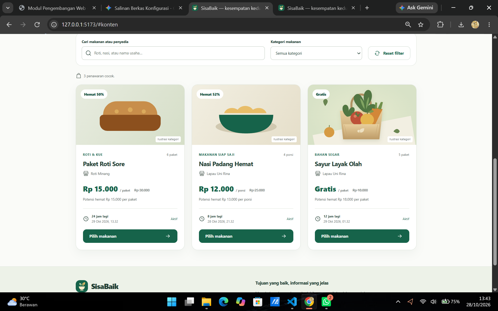
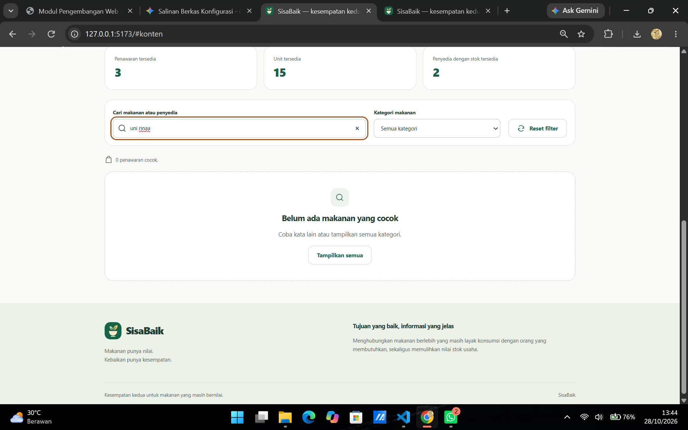

# Dokumentasi Hasil Pengujian SisaBaik Frontend (Chapter 9)

## 1. Tabel Skenario Pengujian & Penjelasan Teknikal

| Skenario | Ekspektasi | Penjelasan yang Diberikan | Bukti Tangkapan Layar (Screenshot) | 
| ----- | ----- | ----- | ----- | 
| **Pencarian LAPAU** | Dua kartu penawaran Lapau Uni Rina | Pencarian nama dan penyedia tidak peka huruf besar (*case-insensitive*). |  | 
| **Pencarian tidak-ada-produk** | Daftar kosong dan pesan yang sesuai | `v-if`/`v-else` mengikuti state `computed` katalog. |  | 
| **Reset filter lalu pilih kategori roti** | Satu kartu Paket Roti Sore | Event anak (*child component*) memperbarui filter induk (*parent state*). |  | 
| **Pilih Paket Roti Sore** | Ringkasan mendapat fokus; stok tetap 6 | Event `pilih` tidak membuat pesanan (hanya memilih di UI). |  | 
| **Beralih ke mode penyedia** | 3 kartu Rina; 2 tersedia; 9 unit | Draft tetap tampil; perhitungan tersedia hanya dari data Rina. |  | 
| **Submit form kosong** | Kesalahan mendapat fokus; daftar tetap 3 | Payload tidak di-emit ketika validasi form invalid. |  | 
| **Isi harga normal 20000 dan penawaran 30000** | Kesalahan harga, daftar tidak bertambah | Validasi hubungan |  | 
